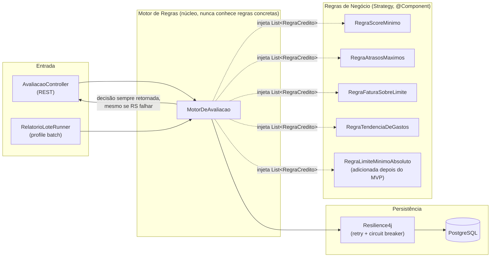

# Sistema de Regras para Crédito Rotativo

Case técnico Itaú — Engenharia de Software Backend ("CE 3 - Sistema de Regras para Crédito
Rotativo em Cartão de Crédito"). Motor de regras extensível que avalia clientes fictícios e decide
liberação de crédito rotativo + valor máximo, exposto via API REST e um modo de execução em lote.

Documentação completa (spec, plano, decisões técnicas) em
[`specs/001-revolving-credit-engine/`](specs/001-revolving-credit-engine/). Uso de IA neste case
documentado na seção [Uso de IA neste case](#uso-de-ia-neste-case), ao final deste README.

## Stack

Kotlin 2.0.0 / JVM 21, Spring Boot 4.1.0 (Web, Data JPA, Validation, Actuator), PostgreSQL 16
(Docker), Flyway, Resilience4j, Micrometer/Prometheus, JUnit5 + Testcontainers.

## Como rodar

Pré-requisitos: JDK 21 (o compilador Kotlin desta versão falha em JDK 25), Docker.

```bash
make db-up      # sobe o Postgres (docker compose), espera ficar healthy
make migrate    # aplica as migrations Flyway (cria cliente / decisao_avaliacao / resultado_regra)
make seed       # opcional: alguns clientes de exemplo direto via SQL
make run        # sobe a API em http://localhost:8081
```

Avaliar clientes via API:

```bash
curl -X POST http://localhost:8081/api/v1/avaliacoes \
  -H "Content-Type: application/json" \
  -d '{
    "clientes": [
      {
        "cpf": "12345678901",
        "nome": "Maria Souza",
        "scoreCredito": 720,
        "valorFaturaAtual": 800.0,
        "limiteDisponivel": 3200.0,
        "numeroAtrasos": 0,
        "comportamentoGastos": [
          {"mes": "2026-06", "valor": 700.0},
          {"mes": "2026-07", "valor": 750.0},
          {"mes": "2026-08", "valor": 800.0}
        ]
      }
    ]
  }'
```

Gerar o relatório em lote (reaproveita o mesmo motor, processa `fixtures/clientes-demo.json` e
grava um arquivo novo por execução em `relatorios/relatorio-<data-hora UTC>.json`, fora do git;
um exemplo de saída fica versionado em `fixtures/relatorio-demo.json`):

```bash
make run-batch
```

O relatório traz `geradoEm`, um `resumo` (recebidos, avaliados, aprovados, reprovados, inválidos e
valor total liberado) e as seções `aprovados`, `reprovados` e `invalidos`. Cada item avaliado traz
o `decisaoId` e o `avaliadoEm` gravados em `decisao_avaliacao`, para cruzar o relatório com a auditoria
no banco. Cada registro é isolado: um cliente
que viola a validação ou que tem um campo com tipo errado no JSON vai para `invalidos` (com o
índice no arquivo e o motivo) sem impedir a avaliação dos demais. A fixture de demonstração inclui
de propósito dois registros assim. O CPF aparece completo no relatório por ser o artefato de
negócio consumido pela área de crédito, assim como na resposta da API; nos logs ele é sempre mascarado.

Rodar os testes (sobe Postgres efêmero via Testcontainers — não depende do `make db-up`):

```bash
make test
```

Encerrar o ambiente:

```bash
make down
```

Métricas: `curl http://localhost:8081/actuator/prometheus` — expõe `avaliacoes_total`,
`avaliacoes_aprovadas_total`, `avaliacoes_reprovadas_total` e o timer de latência de decisão.

Collection pronta pro Insomnia (endpoint de avaliação + actuator, com exemplos de aprovado/reprovado/
inválido/lote vazio) em [`docs/insomnia_collection.json`](docs/insomnia_collection.json) — importar
via File > Import.

## Arquitetura



- **Extensibilidade (Strategy)**: cada regra implementa a interface `RegraCredito` e é descoberta
  automaticamente pelo Spring (`@Component`). `MotorDeAvaliacao` recebe `List<RegraCredito>` via
  injeção de dependência — nunca referencia uma regra por nome. Adicionar uma regra é adicionar
  uma classe; nenhuma edição em `engine/MotorDeAvaliacao.kt` é necessária (ver
  `RegraLimiteMinimoAbsoluto`, adicionada depois do MVP, e
  `MotorDeAvaliacaoSpringWiringTest`, que prova isso automaticamente).
- **Explicabilidade**: todas as regras são sempre avaliadas (nunca há curto-circuito); a decisão
  final carrega o resultado de cada uma (`ResultadoRegra`), persistido e retornado na API.
- **Resiliência**: a decisão é calculada 100% em memória antes de qualquer I/O; a escrita no
  Postgres é envolvida por retry + circuit breaker (Resilience4j) + transação única (`@Transactional`
  em `DecisaoPersistenceService`) — uma falha de persistência nunca impede a resposta já calculada
  ao chamador, e nunca deixa uma decisão gravada sem suas regras associadas. Verificado derrubando o
  Postgres com a API rodando: a resposta continua correta (HTTP 200). As primeiras requisições levam
  ~3,2s (3 tentativas × `connection-timeout` de 1s do HikariCP — eram ~30s com o timeout padrão,
  ver [`research.md` §8](specs/001-revolving-credit-engine/research.md#8-timeout-de-conexão-do-hikaricp-e-transação-atômica-na-persistência)); assim que o circuit breaker abre, caem para ~2ms, e a
  gravação volta sozinha quando o banco retorna. Esse pico inicial excede o alvo de 1s — ver
  Limitações.

## Regras de negócio (propostas e justificadas)

| Regra | Critério | Por quê |
|---|---|---|
| `RegraScoreMinimo` | score ≥ 600 (escala 0–1000) | corte conservador para uma modalidade de crédito sem garantia |
| `RegraAtrasosMaximos` | atrasos ≤ 2 (últimos 12 meses) | mais que isso indica inadimplência recorrente, não pontual |
| `RegraFaturaSobreLimite` | fatura / (fatura + limite) ≤ 80% | pouca folga no limite total aumenta risco de superendividamento |
| `RegraTendenciaDeGastos` | crescimento médio mês a mês ≤ 30% | gasto acelerado sem contrapartida é sinal comportamental de risco |
| `RegraLimiteMinimoAbsoluto` | limite disponível ≥ R$ 50 | demonstração de extensibilidade — adicionada após o MVP |

Valor liberado (clientes aprovados): `limiteDisponivel × fatorScore × fatorFolga`, onde
`fatorScore = min(score/1000, 1)` e `fatorFolga = 1 − fatura/(fatura+limite)`. Detalhes e
alternativas consideradas em
[`specs/001-revolving-credit-engine/data-model.md`](specs/001-revolving-credit-engine/data-model.md).

## Estratégia de testes

- **Unitários** (JUnit5 + kotlin-test): uma classe por regra, cobrindo aprovação, reprovação e
  fronteira; `MotorDeAvaliacao` isolado com regras falsas.
- **Lote**: `ProcessadorLoteTest` cobre o isolamento por registro (tipo errado no JSON, violação de
  validação, mês mal formatado), campos desconhecidos ignorados como na API, lote vazio e a soma do
  valor liberado.
- **Wiring**: `MotorDeAvaliacaoSpringWiringTest` prova a extensibilidade via Spring DI sem subir
  banco.
- **Contrato HTTP + integração**: `AvaliacaoControllerTest`, `AvaliacaoIntegrationTest` e
  `MetricasActuatorTest` rodam contra um PostgreSQL real via Testcontainers — sem mocks de
  repositório, validando schema, persistência e serialização de ponta a ponta.
- `make test` sobe o Postgres de teste automaticamente; não depende de `make db-up`.

## Requisitos não funcionais — como foram endereçados

| NFR | Abordagem |
|---|---|
| Latência ≤ 1s/decisão | Decisão 100% em memória (sem I/O síncrono bloqueante); medida via Micrometer Timer — ~2ms observado localmente |
| Escalabilidade (10k/min) | Argumento de design: serviço stateless, sem estado compartilhado entre requisições → múltiplas réplicas atrás de um load balancer. **Não testado sob carga real neste exercício** (ver Limitações) |
| Extensibilidade | Strategy via Spring DI (ver Arquitetura) |
| Observabilidade | Contadores/timer Micrometer expostos em `/actuator/prometheus`; logs estruturados |
| Segurança/LGPD | CPF e valores financeiros mascarados em todo log (`observability/LogMasking`); autenticação real fora de escopo (ver Limitações) |
| Resiliência | Retry + circuit breaker (Resilience4j) + transação única na escrita de persistência; decisão nunca é perdida por indisponibilidade do banco — verificado ao vivo com o Postgres fora do ar: ~3,2s nas primeiras requisições (retries), ~2ms após o circuito abrir; semântica coberta por `DecisaoPersistenceResilienciaTest` |

## Limitações e possíveis evoluções

Simplificações deliberadas deste exercício de 7 dias:

- **Sem autenticação/autorização real** na API — produção exigiria OAuth2/mTLS e controle de
  acesso por perfil; aqui o foco foi o motor de regras.
- **Sem teste de carga real** para os 10.000 avaliações/minuto — a estratégia de escalabilidade é
  documentada (serviço stateless) mas não executada com uma ferramenta como k6/Gatling.
- **Processamento do lote é sequencial** — tanto `AvaliacaoController` quanto `RelatorioLoteRunner`
  avaliam e persistem um cliente por vez. Como `MotorDeAvaliacao` não tem estado compartilhado entre
  clientes, paralelizar (ex.: coroutines com concorrência limitada ao pool de conexões do banco)
  reduziria o tempo total de um lote grande quase proporcionalmente — não implementado neste
  exercício porque o ganho só é perceptível em lotes muito maiores que os de demonstração.
- **`comportamentoGastos` como `jsonb`**: histórico de gastos do cliente é armazenado como `jsonb`
  em `cliente` — simplifica o schema, mas não é indexável por consulta analítica; `motivos` já foi
  normalizado em `resultado_regra` (ver Arquitetura) por ser a auditoria mais provável de precisar
  de SQL indexado por regra.
- **Sem outbox/fila de reprocessamento** para falhas de persistência — hoje uma falha após
  retry/circuit breaker apenas loga o erro; produção real usaria um padrão outbox transacional
  para garantir reprocessamento posterior.
- **Persistência síncrona no caminho da resposta** — com o banco fora do ar, as primeiras
  requisições esperam os retries (~3,2s) até o circuit breaker abrir, excedendo o alvo de 1s.
  Evolução: gravar o histórico de forma assíncrona (ex.: fila/outbox), para que o SLA da decisão
  nunca dependa da disponibilidade do banco.
- **Queda real do banco verificada manualmente** — `DecisaoPersistenceResilienciaTest` cobre a
  semântica de retry/circuit breaker de forma automatizada (falha de repositório simulada: 3
  tentativas antes do fallback; circuito aberto rejeita sem tocar o banco e sem retries), mas a
  queda física do Postgres (ver [`research.md` §8](specs/001-revolving-credit-engine/research.md#8-timeout-de-conexão-do-hikaricp-e-transação-atômica-na-persistência)) foi validada à mão. Evolução natural: um teste
  de integração que pare o container do Postgres e afirme que a API ainda responde 200 dentro de um
  tempo aceitável.
- **Ambiente único via Docker Compose local** — sem HA de banco, sem múltiplas réplicas da
  aplicação, sem stack de observabilidade completa (Prometheus/Grafana não sobem neste exercício,
  apenas o endpoint pronto para scrape).
- **Uma única versão do banco/schema** — sem estratégia de migração blue-green ou rollback
  automatizado além do versionamento Flyway.

## Uso de IA neste case

Divulgação exigida pelo brief ("deixe explícito como e em qual momento do case você usou").
Ferramenta: Claude Code (Claude Sonnet 5), guiando um fluxo em fases do GitHub Spec Kit
(constitution → specify → plan → tasks → implement).

**O que foi decisão minha, não da IA:**

- Persistência em banco real (Postgres, inicializado via `Makefile`) em vez de em memória — a IA
  recomendou memória por simplicidade; discordei e pedi o schema real.
- Aprovação de cada fase (constitution → spec → plan → tasks → implement) antes de deixar a IA
  avançar para a próxima.
- Assumir o conjunto de regras de negócio proposto pela IA (score mínimo, atrasos, fatura/limite,
  tendência de gastos) depois de revisar a justificativa e os thresholds de cada uma.
- Normalizar `motivos` em uma tabela `resultado_regra` em vez do `jsonb` inicialmente proposto —
  para permitir auditoria/consulta por regra via SQL, mesmo custando uma tabela e um `saveAll`
  extra na camada de persistência (ver `data-model.md`).
- Revisão final do código, do relatório em lote gerado e de uma chamada real à API (Docker +
  Postgres + curl) antes de aceitar o trabalho como concluído.
- Revisão crítica pós-implementação (também assistida por IA) que identificou que o retry da
  persistência nunca disparava — o fallback do circuit breaker absorvia a exceção antes do retry
  vê-la. Decidi corrigir escrevendo primeiro um teste que reproduzia o problema
  (`DecisaoPersistenceResilienciaTest`) e medir o impacto real com o banco fora do ar (~3,2s nas
  primeiras falhas até o circuito abrir), documentando o trade-off em vez de escondê-lo.

**Como a IA foi usada:** propôs spec, plano e stack a partir do PDF do case (com pontos de decisão
explícitos — ver acima) e escreveu o código Kotlin, a configuração e os testes, iterando sobre
`./mvnw compile`/`test` até tudo passar e validando ponta a ponta com Docker real (Postgres real,
`make run-batch`, chamada de API via `curl`). O raciocínio técnico de cada decisão está registrado
em [`research.md`](specs/001-revolving-credit-engine/research.md), incluindo uma particularidade de
ambiente (Spring Boot 4.1.0) que exigiu pivotar a estratégia de teste de contrato — ver
[`research.md` §6](specs/001-revolving-credit-engine/research.md#6-webmvctest-não-disponível-como-slice-leve-neste-setup--pivot-para-springboottest--testcontainers).
